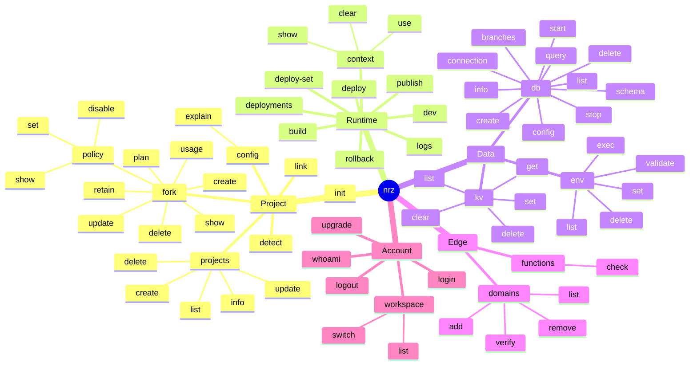

# Инвентаризация команд nrz-cli

Срез: 2026-07-14.

Проверено по текущему коду и help текущего debug-бинаря:

- `src/cli/mod.rs` - верхнеуровневый `Command` enum и глобальные флаги.
- `src/main.rs` - dispatch всех команд в handlers.
- `src/cli/*` и профильные modules (`deploy`, `build`, `dev`, `init`, `auth`).
- Endpoint-контракты входят в `api/openapi.json`; HTTP fixtures проверяют generated SDK и handlers.
- `cargo build --quiet`.
- `target/debug/nrz --help` и help для основных вложенных команд.

Live API-команды не выполнялись. Это статический разбор текущей CLI-поверхности и handlers, не проверка доступности backend endpoints.

## Схема команд

## Глобальный контракт

Все команды принимают глобальные флаги:

| Флаг / env | Что делает |
| --- | --- |
| `--json`, `NRZ_JSON` | Машинный режим. Основной результат идет JSON-объектом в stdout, progress/status в JSON-mode пишется structured JSON lines в stderr. |
| `--human`, `NRZ_HUMAN` | Принудительно включает human output и подавляет auto-JSON. |
| `--token`, `NRZ_TOKEN` | Явный API token. |
| `--workspace`, `NRZ_WORKSPACE` | Workspace slug для выбора сохраненного токена/контекста. |

Важный runtime нюанс: если stdout не TTY, CLI сам включает JSON mode, если не передан `--human`.

Platform execution context выбирается единообразно:

| Команда | `--environment` / `NRZ_ENVIRONMENT` |
| --- | --- |
| `nrz deploy` | Точный Environment для admission и неизменяемого deployment snapshot. |
| `nrz dev` | Точный Environment для локальной материализации; `--local` явно отключает platform config. |
| `nrz env ...` | Окружение выбранного Service. Для записи или удаления его значения по умолчанию укажите `--all`. |
| `nrz rules pull/publish/status` | Точный Environment для чтения и публикации Edge Rules. |
| `nrz functions invoke` | Точный Environment с активной Function revision. |
| `nrz domains add` | Точный Environment для нового hostname binding. |

Приоритет: explicit flag → `NRZ_ENVIRONMENT` → gitignored
`.onreza/environment.json`. `nrz context use <environment>` сохраняет выбор для
checkout. Legacy `--env`/`NRZ_ENV` остался только у локального KV namespace.

Admission `deploy` передаёт `expectedContext` с разрешёнными Product, Service, Source,
ProductEnvironment, Workspace Environment и workspace binding generation. Если
канонический target изменился, ответ `409 CONFLICT` завершает команду до сборки;
повторный запуск заново разрешает context.
После admission server-origin build settings обновляются из frozen runner snapshot.
Явные CLI/onreza.toml overrides и локальный выбор DIR/`--app` сохраняют приоритет.
`deploy --dry` без admission читает текущие настройки Service (включая выбор
через `--service-id` или сохранённый context), а не snapshot будущего деплоя.

## Верхнеуровневые команды

| Команда | Что умеет сейчас | Ключевые флаги / особенности |
| --- | --- | --- |
| `nrz dev [DIR]` | Материализует выбранный Environment snapshot и запускает локальный dev server с ONREZA bootstrap и KV/context emulator. | `--environment`, `--local`, `--alias`, `--command`, `--port`, `--inspect`, `--inspect-brk`, `--db-branch`. `--local` — единственный local-only путь. |
| `nrz build [DIR]` | Находит output dir, валидирует `.onreza/manifest.json` или генерирует manifest для supported static/SSR outputs. | `--skip-validation`. |
| `nrz deploy [DIR]` | До сборки выполняет admission, получает неизменяемый Environment snapshot, затем запускает install/build с ним, загружает source/functions и отслеживает live status. Каждый Function entrypoint до publish загружается точным подписанным STABLE runtime; `--dry` выполняет тот же preflight. | `--environment`; `--prod` — compatibility selector для Environment `production` и конфликтует с `--environment`. Также: `--project-id`, `--service-id` для точного Service, `--dry`, `--verify`, `--skip-build`, `--skip-install`, `--build-command`, `--skip-env-check`, `--compute static|process`, `--health-check-path`, `--app` (`--filter` alias). Internal runner resume скрыт из help. |
| `nrz context ...` | Сохраняет выбор окружения и сервиса для checkout. | `use <ENVIRONMENT> [--service <UUID>]`, `show`, `clear`. |
| `nrz detect [DIR]` | Определяет framework, package manager, runtime/build metadata, monorepo packages. | `--slug-only`, `--save`. Internal remote-detection flags `--stdin` и `--needed-files` скрыты из help. |
| `nrz config explain [DIR]` | Показывает effective build/deploy config с учетом root/app config, CLI override и server project settings. | `--app` (`--filter` alias), `--project-id`, `--service-id`, `--local`. Без `--local` при наличии project id пытается fetch server settings. |
| `nrz init` | Создает local scaffold (`onreza.toml`, `.onreza/`, `.gitignore`) и опционально создает/линкует platform project. | `--name`, `--skip-detection`, `--create`, `--project-id`, `--local`. В JSON/non-interactive без `--create/--project-id` остается local-only. |
| `nrz link [DIR]` | Линкует текущую директорию к platform project и обновляет `onreza.toml`. | `--project-id`; в JSON mode обязателен, иначе interactive selection. |
| `nrz deployments` | Список deployments проекта. | `--limit` (1..100, default 10), `--project-id`. |
| `nrz logs` | Runtime logs проекта с фильтрацией. | `--deployment-id`, `--project-id`, `--limit` (1..1000, default 50), `--search`. |
| `nrz deploy-set` | Принимает один выбранный набор Services и ждёт переключение полного состава; остальные Services сохраняют exact accepted references. | `--project-id`, `--environment`, `--all` либо повторяемый `--service-id`; повторяемый `--local SERVICE_ID=PATH` для локальных Sources, `--expected-generation`, `--idempotency-key`. Receipt в `.onreza/deployment-sets` сохраняет первоначальный запрос для unknown-outcome retry. |
| `nrz fork --product-id <UUID> ...` | Планирует и создаёт копию работающего Product, читает состояние и стоимость, обновляет Services, продлевает срок и запускает очистку; управляет PR policy точного Source. | `plan/create/update --spec <JSON>`; `show/usage/retain/delete <FORK_ID>`; `retain --expires-at <UTC>`; `delete --force` для non-interactive/JSON; `policy <SOURCE_ID> show/set --spec/disable --expected-generation`. |
| `nrz publish` | Предварительно проверяет или публикует выбранные Services из точного протестированного состава в целевое окружение. | `--target-environment`, `--source-environment`, `--source-composition`, повторяемый `--service`; `--preview` либо UUIDv7 `--idempotency-key`; `--confirmations <JSON>` передаёт точные подтверждения замен из preview. Preview несовместим с ключом и подтверждениями. |
| `nrz rollback` | Запрашивает новую активацию сохранённого immutable release в выбранном Environment. | `--release-id` или `--composition-id` для активации либо `--list` для списка; `--environment`, `--project-id`, `--service-id`, `--dir`; для `--list` paired cursors `--before-created-at`/`--before-release-id` и `--before-composition-created-at`/`--before-composition-id`. По умолчанию ждёт финального наблюдения текущего rollout; `--finish-observation-early` завершает это наблюдение раньше для этой операции, сохраняя grace и drain. Операция асинхронна; фактический active определяется Edge receipt. |
| `nrz functions check [DIR]` | Загружает Functions через точный STABLE runtime и проверяет `onreza.rules.toml`. | Runtime скачивается в пользовательский cache при первом Function-check; ошибка `ONREZA_FUNCTIONS_NOT_FOUND`, если нет function entries и rules-файла. |
| `nrz kv-v2 ...` | Remote binary KV Stores и branches через `/v1/kv-v2`. | `regions`, `stores`, `branches --store <UUID>`, `data --store <UUID> --branch <UUID>`; общий workspace/token resolver. |
| `nrz kv ...` | Локальный KV store для dev/emulator state. | Не ходит в API. Хранилище: `.onreza/data/kv.<env>.json` от текущей директории; default env namespace `development`. |
| `nrz db ...` | Managed PostgreSQL (kaiki) операции. | Management идет через `/v1/kaiki/databases`; выбранный Product видит собственные DB и явно связанные через `projectAttachments`. `query` и `schema` получают connection URI через API и выполняют SQL локально из `nrz`. Exact DB ID задаёт ресурс напрямую с проверкой API authority; выбор по имени/config или auto-resolve требует единственного совпадения в workspace либо выбранном Product. Binding не выводится из Git ref или branch name. |
| `nrz env ...` | Безопасное управление platform env vars, проверка и запуск команд с материализованным snapshot. | `--project-id` global внутри группы; точный context выбирается через `--environment`/`NRZ_ENVIRONMENT`/`nrz context`. Dotenv pull/push отсутствуют. |
| `nrz domains ...` | Custom domain hostnames проекта через workspace-domain API. | `--project-id` global внутри `domains`; `add --environment` использует единый execution-context resolver и создает/переиспользует workspace domain zone. |
| `nrz services ...` | Список Services/Sources, создание отдельного CLI или Git Source, создание/редактирование точного Service и асинхронное удаление с сохранением Product DB/KV. | `list`, `create-source`, `create`, `update <SERVICE_ID>`, `delete <SERVICE_ID>`; `--project-id`, для Git Source — `--git-url`, optional `--git-connection-id`; для configure — `--name`, `--source-id`, `--source-ref`, `--root-directory`; при создании также `--framework`, `--package-manager`, `--install-command`, `--build-command`, `--output-directory`. |
| `nrz endpoints ...` | Сеть, exports/imports и фактический applied state точного Service+layer. | Обязательны `--project-id`, `--service-id`, `--environment-id`; `list`, `export <LAYER>`, `import <LAYER>`, `network <LAYER> --file`, `exposure <LAYER> public|private`. Mutations используют `--expected-generation`; grant import требует оба Product права, `--revoke` отзывает свой существующий импорт по его generation. |
| `nrz projects ...` | CRUD projects через API. | `create --link` также пишет `onreza.toml` в cwd. |
| `nrz login` | Device flow login или сохранение explicit token. | Если передан `--token`, валидирует `/v1/user` и сохраняет workspace `personal`. |
| `nrz whoami` | Показывает текущего user и workspace context. | Требует token/workspace context. |
| `nrz logout` | Удаляет saved credentials. | `--all` чистит все workspaces; без `--all` удаляет выбранный/default workspace. |
| `nrz workspace ...` | Локальный список/switch сохраненных workspaces. | Не ходит в API. |
| `nrz upgrade` | Self-update из GitHub releases `onreza/nrz-cli`. | `--force`, `--version`, `--channel stable|beta`. |

В `services create` и `services update` флаги `--source-ref` и `--root-directory`
необязательны и передаются только при явном указании. На создании сервер выбирает
действительную default branch Git Source (для CLI Source — `main`) и корень `.`;
на обновлении пропущенные поля сохраняют текущие значения Service. `--name` и
`--source-id` обязательны в обоих случаях.

## DB subcommands

| Команда | Назначение | Опции |
| --- | --- | --- |
| `nrz db list` | Список managed databases workspace; выбранный Product сужает список. | `--project-id`. |
| `nrz db create` | Создает самостоятельную managed DB без неявного app binding. | `--name`, `--cu-size`, `--wait`, `--idempotency-key <UUIDv7>`; приложение подключается отдельным `db config`. |
| `nrz db info [DATABASE]` | Детали DB. | DB можно указать ID/name; иначе auto-resolve. |
| `nrz db delete <DATABASE>` | Удаляет DB. | `--force` для non-interactive/JSON. |
| `nrz db start [DATABASE]` | Запускает stopped DB. | DB optional, auto-resolve требует единственного подходящего ресурса в выбранном scope. |
| `nrz db stop [DATABASE]` | Останавливает running DB. | DB optional, auto-resolve требует единственного подходящего ресурса в выбранном scope. |
| `nrz db operation <OPERATION_ID>` | Читает durable operation, в том числе после удаления DB. | `--database <UUID>` или сохранённый `[db].database`; `--wait` ждёт терминального статуса. |
| `nrz db connection [DATABASE]` | Печатает connection string. | `--branch` для branch connection. |
| `nrz db query [SQL]` | Выполняет SQL локально с устройства через PostgreSQL connection URI. | API используется только для auth/project/database resolution и получения connection URI. `--database`, `--file`, `--branch`; если SQL и file не заданы, читает stdin. |
| `nrz db branches [list]` | Список branches. | `--database`; subcommand optional, отсутствие subcommand = `list`. |
| `nrz db branches create <NAME>` | Создает branch. | `--database`, `--idempotency-key <UUIDv7>`. |
| `nrz db branches delete <BRANCH>` | Удаляет branch по ID/name. | `--database`. |
| `nrz db branches connection <BRANCH>` | Печатает branch connection string. | `--database`. |
| `nrz db config [DATABASE]` | Показывает все Service bindings выбранного Product или создаёт/меняет один точный binding. | Для изменения обязательны `--service-id`, `--product-environment-id`, `--owner-product-environment-id`, `--provider-branch-id`. Настройки: `--auto-inject true|false`, `--env-var`, `--preview-branches true|false`, `--functions-default true|false`. |
| `nrz db schema [DATABASE]` | Локальная интроспекция `public` schema через PostgreSQL connection URI. | `--branch`. |

Текущее DB-семейство - managed PostgreSQL. Старые D1/SQLite migration команды в текущем CLI отсутствуют.

## Env subcommands

Укажите Service через `--service <UUID>` или сохраните его командой
`nrz context use <environment> --service <UUID>`. Единственный Service
выбирается автоматически.

| Команда | Назначение | Опции |
| --- | --- | --- |
| `nrz env list` | Показывает переменные выбранного Service. Значения секретов скрыты. | В выбранном окружении учитываются его переопределения. |
| `nrz env set <KEY>` | Записывает значение по умолчанию (`--all`) или переопределение для окружения. | `--environment <name-or-id>`, `--value` для plain, `--stdin` или `--from-file` для secret. Категорию задаёт `--secret`, `--plain` или `[env.declarations]`. |
| `nrz env delete <KEY>` | Удаляет значение в выбранной области одного Service. | `--all` удаляет default и сохраняет overrides. Удаление override в `--environment <name-or-id>` открывает унаследованное значение, если оно задано. Для автоматизации используйте `--yes`. |
| `nrz env validate` | Материализует один context и сверяет key set с `[env.declarations]`. | Значения не выводятся; missing required vars возвращают ошибку. |
| `nrz env exec -- <COMMAND>` | Запускает процесс с одним materialized Environment snapshot. | Private CLI credentials удаляются из child environment. |

## Project/account subcommands

| Команда | Назначение | Опции |
| --- | --- | --- |
| `nrz projects list` | Список projects. | `--limit` (1..100, default 20). |
| `nrz projects create --name <NAME>` | Создает project. | `--display-name`, `--git-url`, `--branch`, `--framework`, `--package-manager`, `--install-command`, `--build-command`, `--output-directory`, `--link`. Пропущенная branch выбирается по основной ветке репозитория. |
| `nrz projects info <ID>` | Детали Product и список его окружений с именами, типами и ID, включая Product без приложения. | `--service-id` выбирает приложение в multi-Service Product. JSON содержит `environments`; пустой список показывается явно. App-поля без выбранного Service возвращаются как `null`; app settings commands требуют приложение и возвращают `APPLICATION_SERVICE_REQUIRED`. |
| `nrz projects update <ID>` | Обновляет project settings. | `--service-id`, `--display-name`, `--git-url`, `--branch`, `--framework`, `--package-manager`, `--install-command`, `--build-command`, `--output-directory`, `--root-directory`, `--node-version`. Без полей падает. |
| `nrz projects delete <ID>` | Удаляет project. | `--force` для non-interactive/JSON. |
| `nrz workspace list` | Список локально сохраненных workspaces. | Local config only. |
| `nrz workspace switch <SLUG>` | Меняет default workspace. | Local config only. |

## Domains, KV, Functions

| Команда | Назначение | Опции |
| --- | --- | --- |
| `nrz domains list` | Список custom domain hostnames проекта из workspace-domain projection. | `--project-id`. |
| `nrz domains add <DOMAIN>` | Привязывает hostname к Service в environment через workspace-domain API. | `--service-id` обязателен для multi-Service Product; `--environment` либо `NRZ_ENVIRONMENT` или repository context, без implicit production fallback. |
| `nrz domains remove <DOMAIN_ID>` | Удаляет hostname binding. | `--project-id`. |
| `nrz domains verify <DOMAIN_ID>` | Запускает verify/check parent workspace domain zone для hostname binding. | `--project-id`. |
| `nrz kv get <KEY>` | Читает local KV value. | `--env`; expired values считаются отсутствующими. |
| `nrz kv set <KEY> <VALUE>` | Пишет local KV value. | `--env`, `--ttl`, default `0` без expiry. |
| `nrz kv delete <KEY>` | Удаляет local KV key. | `--env`. |
| `nrz kv list` | Список local KV keys. | `--env`, `--prefix`, `--limit` (default 100). |
| `nrz kv clear` | Удаляет весь local KV файл выбранного env namespace. | `--env`, `--force` обязателен для реальной очистки. |
| `nrz kv-v2 regions` | Доступные регионы для Store или пустой branch. | `--store <UUID>` ограничивает выбор совместимыми регионами Store. |
| `nrz kv-v2 stores list/create/info/delete` | Управляет remote Stores и основной branch. | `list --after <UUID> --limit <1..100>`; `create <NAME> --region <ID> [--id <UUID>] [--main-branch-id <UUID>] [--batch-window-ms <MS>]`; `info/delete <UUID>`, для non-interactive delete обязателен `--force`. |
| `nrz kv-v2 branches --store <UUID> ...` | Список, пустая branch, info, retirement, CoW fork и batching. | `list --after <UUID> --limit <1..100>`; `create <NAME> --region <ID> [--id <UUID>] [--batch-window-ms <MS>]`; `info/delete <UUID>`; `fork <SOURCE_UUID> <NAME> [--id <UUID>]`; `batch-window <UUID> <MS>`. Delete требует `--force` в non-interactive. Fork может вернуть `PENDING`; готовность читается через `info`. |
| `nrz kv-v2 data --store <UUID> --branch <UUID> ...` | Binary get/put/delete, ограниченный keys scan, flush и stats. | `get <KEY>`, `put <KEY> <VALUE> [--durable]`, `delete <KEY> [--durable]`, `keys [--prefix <KEY>] [--after <KEY>] [--limit <1..1024>] [--max-bytes <1..1048576>]`, `flush`, `stats`. `--base64` у get/put/delete/keys задаёт canonical padded base64 входов; иначе входы UTF-8. Ответы сохраняют wire base64. |
| `nrz functions check [DIR]` | Загружает local Functions точным platform runtime и проверяет rules payload до publish/deploy. | JSON output включает runtime identity, загруженные entrypoints и Edge Rules report. |
| `nrz functions runtime install/status/path` | Управляет локальным cache точного STABLE runtime. | Обычные `functions check` и `deploy` устанавливают runtime автоматически; эти команды нужны для диагностики и offline-подготовки. |
| `nrz functions invoke <NAME>` | Вызывает активную Function revision выбранного Service. | `--service-id` обязателен для multi-Service Product; `--environment` или общий сохранённый context. |
| `nrz rules pull/publish/status` | Читает или публикует user-authored Edge Rules. | `--environment` или общий сохранённый context. |

Remote KV v2 использует buffered acknowledgement по умолчанию и batching window
100 ms для новых branches; `--durable` ожидает durable acknowledgement конкретной
записи, `flush` делает предыдущие buffered writes durable и не удаляет данные.
Mutations автоматически не повторяются. `OUTCOME_UNKNOWN` означает, что запись могла
примениться: команда завершается с ошибкой, а решение о повторе принимает caller.
При ошибке создания Store/branch/fork сообщение сохраняет отправленные UUID; ручной
повтор использует те же IDs и неизменный запрос. JSON mode выводит один объект в
stdout, human mode — читаемый JSON в stderr с безопасным отображением терминальных управляющих символов.

## Найденные устаревшие или мертвые упоминания

В текущем `Command` enum и handlers нет неиспользуемых верхнеуровневых clap variants: все варианты из `src/cli/mod.rs` покрыты в `src/main.rs`.

Были найдены устаревшие упоминания команд в документации/skills; в рамках cleanup они удалены или заменены на актуальные команды:

| Упоминание | Где найдено | Статус сейчас |
| --- | --- | --- |
| `nrz db shell` | `README.md`, `docs/onreza-toml.md` | Команды нет в `DbCommand`; упоминания заменены. |
| `nrz db execute` | `README.md`, `skills/nrz-cli-env-db-kv/SKILL.md` | Команды нет; заменено на `nrz db query [SQL]`. |
| `nrz db migrate create/status/apply` | `README.md`, `skills/nrz-cli-env-db-kv/SKILL.md`, `skills/nrz-cli-deploy/SKILL.md` | Команд нет; упоминания удалены. |
| `nrz db migrate ... --remote` | skills | Команд и `--remote` флага нет; упоминания удалены. |
| `nrz db push` | `docs/onreza-toml.md` | Команды нет; упоминание удалено. |
| `nrz db reset --remote` | `skills/nrz-cli-ci-automation/SKILL.md` | Команды и `--remote` флага нет; упоминание удалено. |
| `[deploy].skip_migrations`, `[migrations]`, `[db].default_env` | `docs/onreza-toml.md` | В текущем `src/` не используются; удалены из docs. |
| `nrz env pull/push` | docs/skills/examples | Команды удалены: Server — source of truth, ephemeral локальное использование идет через `nrz env exec`. |

Практический вывод: после cleanup текущая поверхность стала логичнее. Главные оставшиеся продуктовые решения, если они понадобятся позже: нужен ли отдельный интерактивный `db shell`, и нужно ли переносить local KV state из старого `.onreza/data/kv.json` в новый env-scoped файл автоматически.

### Database selection and generated API

Managed database commands use the generated OpenAPI client. Without an explicit
ID/name or `[db].database`, selection requires a unique auto-inject attachment,
or a unique project attachment when auto-inject is disabled. Ambiguous names or
attachments require an exact ID; response ordering never selects a database for
a mutation. Explicit database and branch UUIDs go directly to the requested endpoint, where
the API checks authority. Branch names and legacy opaque branch IDs are resolved
against the database branch list.

Native v2 create/delete/start/stop and branch create/delete return an operation
receipt in both output modes, for accepted HTTP 202 and terminal HTTP 200.
`pending`/`running` describe acceptance; `succeeded` confirms completion. The
allowlisted JSON includes `operationId`, `operationType`, `status`, `result` and
available `pendingReason`/`errorCode`, never the POST-only password. Legacy HTTP
200 response projections remain supported.

`nrz db create --wait --json` follows native operations through their receipt GET
and emits the final receipt. Legacy creation retains its database readiness
polling and information projection. Waiting fails on `failed`/`cancelled` and
reports the durable error code. Plain operation inspection prints failed status
without turning the read itself into a failed command.

Create and branch creation send one UUIDv7 Idempotency-Key per attempt. The key
is shown before the request (in structured stderr progress when using JSON) and
included with native JSON receipts. Preserve stderr when the response can be
lost: stdout remains one error object on failure. To repeat an attempt after an
uncertain network outcome, preserve the key and exact request:
`nrz db create --name primary --idempotency-key <UUIDv7>`. No mutation is retried
automatically.

`nrz db operation <OPERATION_ID> --database <DATABASE_UUID> [--wait]` reads the
receipt without requiring a live database list/detail or connection read. A
UUID in `[db].database` works after deletion as well. Receipt reads recheck API
permissions; denied requests do not fall back to other endpoints.

Interactive project selection (`nrz link` and unlinked `nrz deploy`) reads all
project pages. Missing or repeated pages produce an error instead of presenting
an incomplete list.
